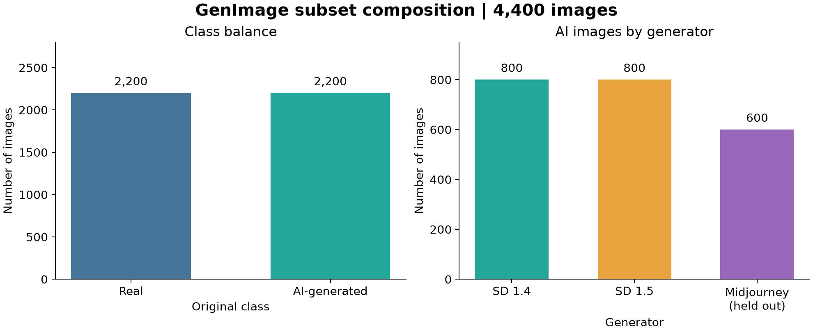
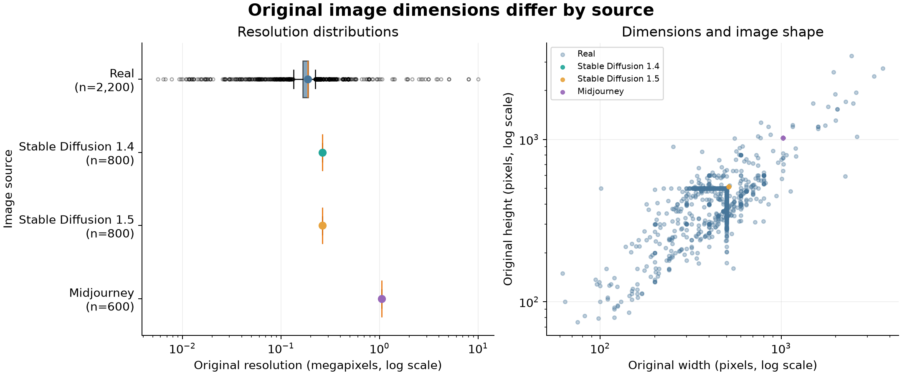

# GenImage project data

Updated November 19, 2026. This folder contains the original local image pool and final analyzed dataset.

## Folder contents

```text
DATA/
  README.md
  original/
    GET_DATA.md
    images/                 # 4,707 unchanged downloads; tracked with Git
    original_files.csv      # complete local file inventory with SHA-256
    source_manifest.csv     # provenance for the selected 4,400, before assigned splits
    source_inventory.json   # original archive locations
  cleaned/
    dataset_manifest.csv    # final modeling copies, source metadata, and splits
    images/                 # 4,400 RGB JPEG modeling copies at 224 x 224; tracked with Git
    requirements.txt        # preparation and analysis dependencies
    preprocessing_audit.json # checks of the standardized modeling copies
    split_counts.csv
    quality_audit.json
    preparation_audit.json
    rejected_candidates.csv
    eda_summary.json
    plot1.png
    plot2.png
```

The final data now includes separate standardized modeling copies in `cleaned/images/`, referenced by `image_path`. The unchanged originals are linked by `original_image_path`. The extra 307 downloads are not part of the analyzed dataset; always load images through `cleaned/dataset_manifest.csv`. `source_manifest.csv` is a provenance view of the selected subset, not a complete pre-filter record of all downloaded candidates. All originals were preserved during organization and preprocessing. The earlier full decoding and duplicate audit of the originals is retained in `cleaned/quality_audit.json`; `cleaned/preprocessing_audit.json` records the separate checks of the modeling copies.

The data workflow starts with [01_prepare_dataset.py](../SCRIPTS/01_prepare_dataset.py), which reads the source inventory, selects raw images, filters duplicates, and assigns splits. Its helper [remote_zip.py](../SCRIPTS/remote_zip.py) reads the original multipart archives. [02_explore_data.py](../SCRIPTS/02_explore_data.py) verifies originals and recreates the exploratory plots. [03_preprocess.py](../SCRIPTS/03_preprocess.py) then standardizes the selected images. All paths are anchored to this repository; see the [root README](../README.md) for the full run order.

## Implemented preprocessing

All 4,400 selected images, across both classes and all four splits, were processed identically:

1. Apply EXIF orientation and convert decoded pixels to RGB.
2. Resize the shorter side to 256 pixels using LANCZOS resampling, preserving aspect ratio (round the longer side down to a whole pixel).
3. Take a 224 x 224 center crop, with left/top offsets rounded down. This avoids stretching nonsquare photographs.
4. Save a fresh RGB image as JPEG with quality 95, 4:4:4 chroma subsampling (`subsampling=0`), `optimize=False`, and `progressive=False`. Source EXIF, ICC profiles, and comments are not copied.
5. Reopen every output and verify dimensions, RGB mode, JPEG format, common quantization tables, hashes, and duplicate screening. Recheck all 4,707 original file hashes and confirm labels and split assignments are unchanged.

The script processes only the 4,400 selected records; the 307 unused originals remain untouched. Both test sets remain balanced. Training and held-out evaluation results are stored in `OUTPUT/`. Model-specific tensor normalization is performed when loading these JPEGs, using the chosen pretrained ResNet-50 weights; it is not stored in an image file. Avoid applying the resize/crop procedure again in the model loader.

To reproduce data selection, exploratory analysis, and preprocessing from the project root:

```text
python -m pip install -r DATA/cleaned/requirements.txt
python SCRIPTS/01_prepare_dataset.py
python SCRIPTS/02_explore_data.py
python SCRIPTS/03_preprocess.py
```

Stage 03 is offline and always reads `original_image_path`, so reruns do not repeatedly compress existing modeling copies. It retains labels and splits and updates processed dimensions and hashes in the final manifest only after checks pass. Original measurements remain in `original_*` columns. Both image directories are tracked as regular Git files and are downloaded with a normal clone. See `original/GET_DATA.md` for clone instructions and optional source restoration; this script can recreate modeling copies from the originals. Keep the recorded Pillow version for reproducibility; JPEG bytes can also depend on the JPEG library version recorded in the preprocessing audit.

Re-encoding standardizes the final format but cannot erase all prior JPEG artifacts. Center cropping removes peripheral content, and low-resolution originals are upsampled. These tradeoffs may affect performance and should be reported. Consistent preprocessing reduces these specific confounds; it does not establish that all shortcuts have been removed.

## Final split counts

| Split | Real (SD1.4 source) | SD1.4 AI | SD1.5 AI | Midjourney AI | Total |
|---|---:|---:|---:|---:|---:|
| train | 1,200 | 600 | 600 | 0 | 2,400 |
| validation | 200 | 100 | 100 | 0 | 400 |
| test_seen | 200 | 100 | 100 | 0 | 400 |
| test_unseen | 600 | 0 | 0 | 600 | 1,200 |
| Total | 2,200 | 800 | 800 | 600 | 4,400 |

All Midjourney AI images are exclusively held out. The real controls are genuine dataset-labeled photographs from SD1.4's `nature` collection; no Midjourney-source real photographs are available in this subset. Both test sets contain both classes and support accuracy, precision, recall, and F1 (AI = positive). The data-quality metric checks use synthetic predictions to verify calculations; actual model evaluation is recorded separately in `OUTPUT/`. In those checks, undefined precision is conventionally reported as zero. The unseen set tests a new AI generator, not a new real-photo source. Validation alone should guide model choices.


## 1. Dataset Summary

GenImage pairs real ImageNet photographs with synthetic images for studying image-generation detection. Our downloaded subset contains **4,400 images: 2,200 real and 2,200 AI**, with 800 AI images from each Stable Diffusion version (1.4 and 1.5) and 600 from Midjourney. The [official repository](https://github.com/GenImage-Dataset/GenImage) links the [authors' Google Drive folder](https://drive.google.com/drive/folders/1jGt10bwTbhEZuGXLyvrCuxOI0cBqQ1FS); open the named generator folders to access the multipart archives. Inside each archive, `train`/`val` and `ai`/`nature` encode original splits and labels. We retained those values, ranked paths deterministically with seed 4002, downloaded selected entries through verified HTTP byte ranges, and screened candidates for readability and duplicates. Real images come from SD1.4's nature pool. Midjourney is completely excluded from training and validation. Original image bytes remain unchanged; the CSV maps each local file to its source. See [download instructions](original/GET_DATA.md) for source links and restoration steps.

## 2. Provenance, License, and Ethical Statements

Mingjian Zhu and nine coauthors introduced GenImage in 2023 to evaluate detection across generators and under image degradation. Real photographs originate in ImageNet; synthetic images were produced with eight generators using ImageNet categories, including text prompts for the selected generators. ([Original paper](https://arxiv.org/abs/2306.08571), [repository](https://github.com/GenImage-Dataset/GenImage).) The [dataset license](https://github.com/GenImage-Dataset/GenImage/blob/main/License) specifies **CC BY-NC-SA 4.0 plus additional terms**, explicitly prohibiting commercial use of the data and derivatives. [CC BY-NC-SA 4.0](https://creativecommons.org/licenses/by-nc-sa/4.0/) requires attribution, identification of changes, and share-alike licensing of adaptations. It does not establish all underlying image rights or privacy/publicity permissions; those remain unverified here. Ethical risks include content bias, false accusations of AI use, and using detectors to support misleading authenticity claims. A prediction concerns source patterns, not whether an image depicts a true event; it should not be treated as proof of deception or authorship.

## 3. Data Dictionary

**Model input:** decoded RGB image pixels, loaded using `image_path`; pixels are not stored in the CSV. **Target:** `label`. All other columns are provenance, audit, or analysis metadata and must not be supplied as predictive features. Every selected record has values in every column; `not_applicable` is an explicit value for real images, not a missing generator name.

| Variable | Type | Meaning, values, and uncertainty |
|---|---|---|
| image_path | string | Project-relative path to the processed RGB JPEG in `data/cleaned/images/`; use this for modeling. |
| original_image_path | string | Project-relative path to the unchanged source in `data/original/images/`. |
| label | integer | Binary target: 0 = real, 1 = AI; derived from original folder. |
| label_name | string | Human-readable `Real` or `AI-generated`. |
| generator | string | Stable Diffusion 1.4, Stable Diffusion 1.5, Midjourney; `not_applicable` for real. Exact generation settings are not recorded per image. |
| source_collection | string | `sd14`, `sd15`, or `midjourney`; archive provenance, including for real images. |
| original_label | string | Unchanged source folder: `nature` or `ai`. These are dataset labels, not independent forensic verification. |
| original_split | string | Original `train` or `val` directory; original `val` supplies this project's tests. |
| assigned_split | string | `train`, `validation`, `test_seen`, or `test_unseen`. |
| source_path | string | Full original path inside the multipart archive; preserves filename. |
| source_file_id | string | Google Drive ID of the segment containing the image's local ZIP header. |
| source_disk | integer | Zero-based multipart segment number. Entries can span segments. |
| source_offset | integer | Byte offset of local ZIP header within that segment. |
| compressed_bytes | integer | Compressed ZIP payload length; excludes ZIP headers. |
| zip_crc32 | string | Eight hexadecimal digits from archive, checked after extraction. Read as text to retain leading zeros. |
| width | integer | Width of the processed image: 224 pixels. |
| height | integer | Height of the processed image: 224 pixels. |
| megapixels | float | Processed pixel count / 1,000,000: 0.050176. |
| aspect_ratio | float | Processed width / height: 1.0 after center cropping. |
| format | string | Processed encoding: JPEG, quality 95, 4:4:4 chroma subsampling. |
| color_mode | string | Processed decoded mode: RGB, including converted grayscale originals. |
| file_bytes | integer | Processed JPEG file size in bytes. |
| sha256 | string | 64 hexadecimal digits hashing processed JPEG bytes. |
| pixel_sha256 | string | SHA-256 of decoded processed RGB dimensions and pixels; detects identical decoded content. |
| dhash | string | 64-bit difference hash of the processed image. Distance <=4 triggers review before publishing the manifest; not a complete similarity test. |
| selection_seed | integer | Fixed value 4002 used in deterministic path ranking. |
| original_width, original_height | integer | Encoded source dimensions before EXIF correction or resizing. |
| original_megapixels, original_aspect_ratio | float | Source resolution and width/height ratio. |
| original_format, original_color_mode | string | Source encoding (JPEG or PNG) and decoded mode (RGB or L). |
| original_file_bytes | integer | Original file size in bytes. |
| original_sha256, original_pixel_sha256, original_dhash | string | Original file, decoded-pixel, and visual hashes; preserved for provenance and integrity. |

## 4. Exploratory Question and Findings

The findings, `eda_summary.json`, and dimension plot below describe the original images before preprocessing. The modeling copies are now uniformly 224 x 224 RGB JPEGs; original values are retained in the manifest’s `original_*` columns.

**Do real and AI images differ systematically in resolution, potentially affecting classification?** Yes, the measured source distributions differ:

| Source | Images | Median MP | Width range (px) | Height range (px) | Square (%) |
| --- | --- | --- | --- | --- | --- |
| Real | 2200 | 0.188 | 62–3648 | 75–3264 | 3.6 |
| Stable Diffusion 1.4 | 800 | 0.262 | 512–512 | 512–512 | 100.0 |
| Stable Diffusion 1.5 | 800 | 0.262 | 512–512 | 512–512 | 100.0 |
| Midjourney | 600 | 1.049 | 1024–1024 | 1024–1024 | 100.0 |

Real images have a median resolution of **0.188 megapixels**, and **3.6%** are square. Every selected Stable Diffusion image is **512×512**, while every selected Midjourney image is **1024×1024**. File encodings also differ: Real: 2,200 JPEG; Stable Diffusion 1.4: 800 PNG; Stable Diffusion 1.5: 800 PNG; Midjourney: 600 PNG. There are also 35 real images decoded in grayscale (`L`); all selected AI images decode as RGB. RGB conversion is necessary for consistent model input but does not remove grayscale content. These associations could offer shortcuts based on image shape, resampling, or compression traces. They do **not** show that ResNet-50 exploits those cues or establish perceptual image quality. The common RGB conversion, proportional resizing, center cropping, and JPEG encoding described above have now been applied. Apply weight-specific normalization when loading model inputs, and predefine additional compression evaluations to assess robustness.

**Original-image quality audit (before preprocessing):** 4,400 selected images; 50% real and 50% AI; 0 missing files; 0 unreadable files; 0 hash/dimension mismatches; 0 repeated file hashes; 0 repeated decoded-pixel hashes; 0 selected pairs within the visual-hash cutoff; 0 missing metadata cells. Candidate exclusions: near_duplicate_candidate_dhash_le4: 3. These checks cover the selected subset, not all source images. Selected originals occupy **1.749 GB**. The final cached reconstruction transferred **0.000 GB**. Earlier acquisition transferred at least 1.885 GB of image ranges plus approximately 0.135 GB of archive directories; the complete transfer total was not retained when that run was stopped after Drive quota errors. These access failures are distinct from missing or unreadable selected images.

## 5. Current Unknowns and Limitations

- **Unfamiliar generators:** The unseen holdout contains 600 Midjourney AI images and 600 separate real controls. Keep it excluded from training and model selection; tune only on validation. Results are recorded in `OUTPUT/test_metrics.csv`. Report seen and unseen results separately, with uncertainty and generator-specific recall plus real-image false-positive rates.
- **Processing shortcuts:** Standard resizing does not necessarily remove compression or resampling traces. Compare a fixed baseline with predeclared matched-resolution and JPEG-compression evaluations. Avoid choosing transformations based on test accuracy.
- **Coverage:** Three generators, two closely related SD versions, one real-source pool, and no object-category stratification cannot represent all GenImage or today's generators. A later expansion should balance object categories and include another unrelated generator. Pretrained ImageNet weights may already have seen some real source images; document initialization and evaluate that overlap risk before training.
- **Duplicate uncertainty:** Exact hashes and conservative visual hashes remove detected matches, but crops/edits may remain and simple distinct images may be excluded. Review suspicious similarities before modeling; no claim of exhaustive semantic deduplication is made.
- **Access:** The preferred Drive folders exposed large split archives, not individual images. Bounded range downloads worked on November 12, 2026, but Drive then returned quota-exceeded pages during the final Midjourney requests. We reduced the original 4,800-image target to 4,400 using cached images; reproducing downloads may require waiting for quota reset. No full archive or alternative-host copy was downloaded.

## 6. Refinements to the Research Plan

Refine the question to: **How well does a ResNet-50 trained on Stable Diffusion 1.4/1.5 distinguish real images from AI images, and how much does performance change on held-out Midjourney under consistent preprocessing?** Use 2,400 training images, 400 validation images, 400 seen-generator test images, and 1,200 unseen-generator test images; each split is class-balanced. Preserve source splits: training/validation use original `train`, tests use original `val`. Keep pixels as inputs and labels as targets; exclude metadata and filenames from predictors. Set thresholds on validation, report balanced accuracy, class-wise recall and false positives with confidence intervals, and avoid a pooled score that hides the generalization gap. Training settings and results are recorded in `OUTPUT/training_summary.json` and `OUTPUT/test_metrics.csv`.

## 7. Exploratory Visualizations

### Plot 1 — Dataset composition



The subset is evenly divided between 2,200 real and 2,200 AI images. SD1.4 and SD1.5 each contribute 800 AI images; Midjourney contributes 600. This prevents raw class-count imbalance, while the Midjourney holdout tests a distinct source. The class balance and generator quotas are sampling choices, not evidence of real-world prevalence.

### Plot 2 — Original image dimensions by source



The boxplots compare native resolution separately by source; colored dots mark medians, boxes cover the middle 50%, whiskers cover observations within 1.5 interquartile ranges, and other dots show outliers. A fixed resolution collapses to a line/dot. The width/height plot exposes image shape; identical dimensions overlap. Source-specific patterns motivate standardized preprocessing and robustness checks; they cannot by themselves measure detector performance.


## 8. References

[1] M. Zhu et al., "GenImage: A Million-Scale Benchmark for Detecting AI-Generated Image," in *Advances in Neural Information Processing Systems*, vol. 36, 2023. [Online]. Available: https://arxiv.org/abs/2306.08571

[2] GenImage-Dataset, "GenImage," GitHub. [Online]. Available: https://github.com/GenImage-Dataset/GenImage

[3] GenImage-Dataset, "GenImage Dataset License," GitHub. [Online]. Available: https://github.com/GenImage-Dataset/GenImage/blob/main/License

[4] Creative Commons, "Attribution-NonCommercial-ShareAlike 4.0 International." [Online]. Available: https://creativecommons.org/licenses/by-nc-sa/4.0/
